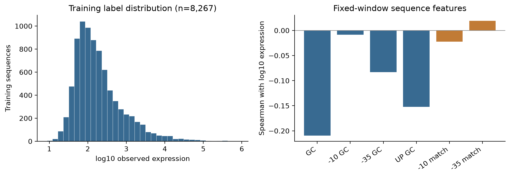
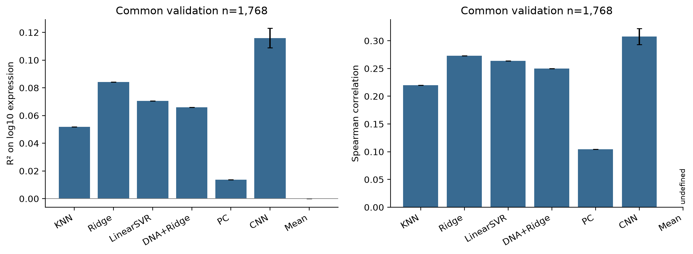
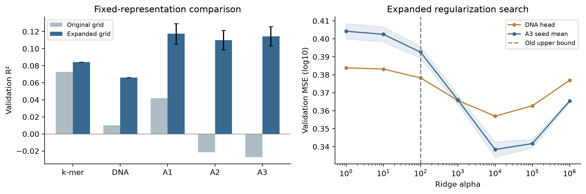
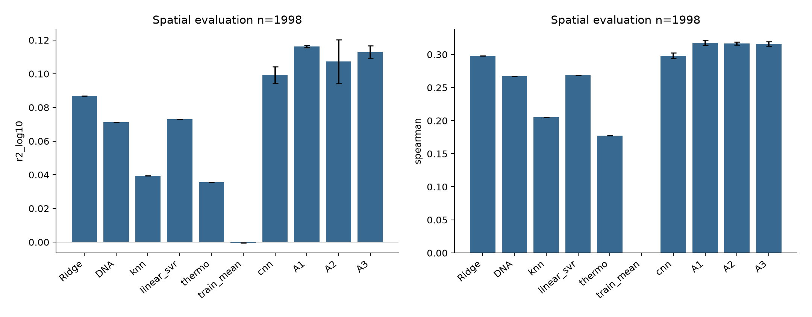
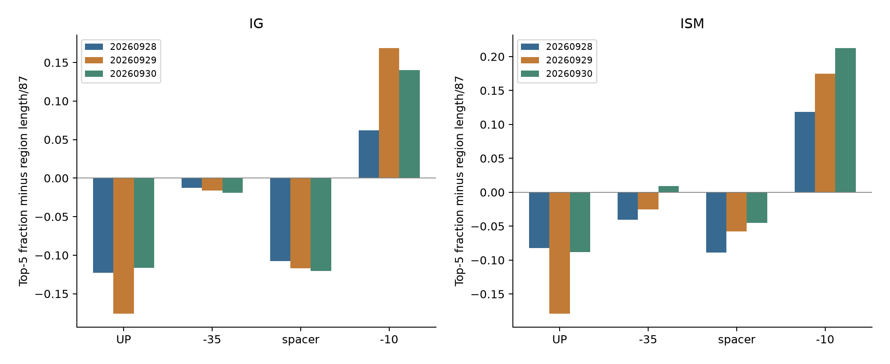
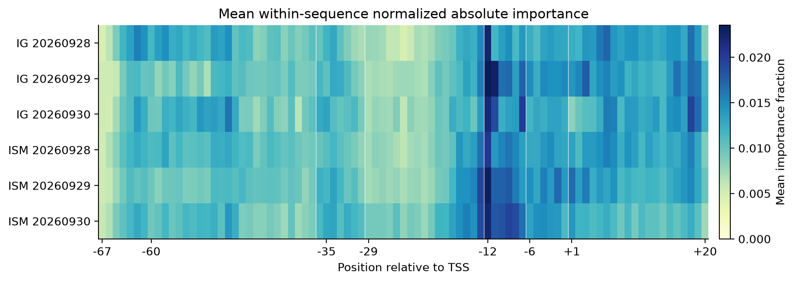
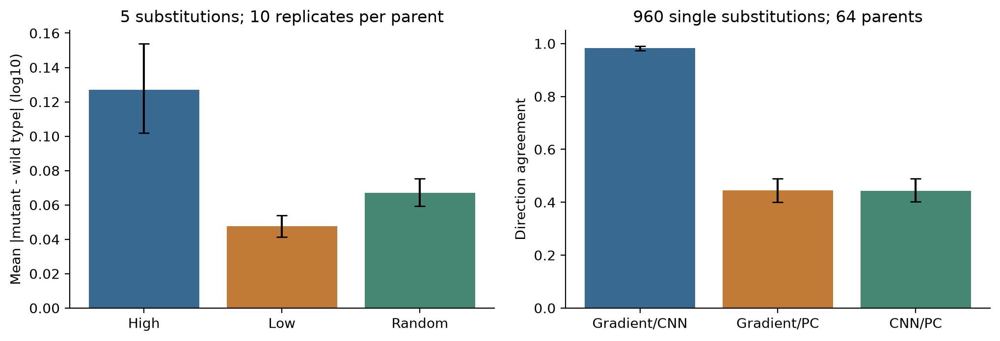
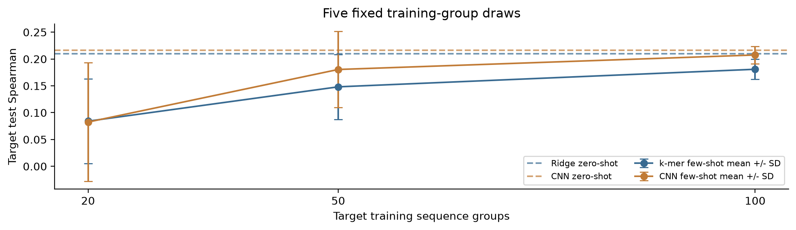

# 启动子强度预测与关键位点归因

PR02-01 课程项目研究报告

2026年10月14日

项目组 胡昊铭、李宇飞、李玘航、田惠今、陈思远

## 摘要

本研究以11,809条TSS位置经核验的大肠杆菌87 bp序列为主数据，比较传统回归、卷积神经网络、冻结DNA预训练表征和Promoter Calculator对启动子相关表达的预测能力，并通过位点归因、计算突变和跨物种迁移分析模型的解释性。回归目标为原始表达关联值的log10变换。

在共同的1,768条验证序列上，纯CNN的三种子平均R²为0.1160，Spearman为0.3077；扩大回归头正则化范围后，k-mer与CNN表征融合的R²为0.1174，继续加入DNA表征和归因区域特征后的R²分别为0.1100和0.1144。重新训练的基因组区域分组对照中，纯CNN和k-mer与CNN表征融合的R²分别为0.0993和0.1162。

IG与ISM均显示−10区域的描述性富集，且该区域现象在三个CNN种子下保持一致；精确位点的跨种子稳定性较低。高归因位点的等数量替换产生更大的预测变化，梯度与CNN单点替换方向一致率为98.23%，反映模型内部的局部自洽性。枯草杆菌100组few-shot冻结CNN在五次训练抽样中的Spearman为0.2075±0.0162，未呈现相对zero-shot CNN的稳定收益。

关键词  启动子强度  卷积神经网络  热力学模型  位点归因  跨物种迁移

### 研究问题

RQ1比较数据驱动模型与热力学模型的预测表现；RQ2检验重要位点与−10、−35、spacer和UP区域的关系；RQ3检验高贡献位点替换对预测强度及方向的影响。

## 1 数据来源与研究设计

主数据取自Wang等发布的Deep_promoter仓库[1]。其天然序列预测任务以公开dRNA-seq转录组数据为基础，原始TSS图谱来自Thomason等[2]。本研究使用仓库中的50 bp序列及其表达标签，经历史参考基因组U00096.2双链精确定位并与原TSS表核对，恢复为覆盖TSS上游67 bp及下游20 bp的87 bp上下文。

原始11,884条记录中，11,809条参考位置唯一，75条多位置命中记录单独排除。上下文恢复保留原标签和继承划分。天然表达关联值还受到细胞状态、转录后过程等因素影响，与孤立启动子的纯转录起始率属于不同观测量；保留文件尚不足以确定每条标签的完整单位及测量条件。

枯草杆菌数据由课程教师提供，共591条61 bp记录、580种不同序列，用作跨物种目标域。重复序列按组划分。文件未附论文、强度单位、TSS和方向信息，迁移评价以Spearman排序相关为主。

表1 数据集与划分

| 数据 | 序列长度 | 训练 开发或验证 评价 |
| --- | --- | --- |
| 大肠杆菌继承划分 | 87 bp | 8,267 / 1,768 / 1,774 |
| 大肠杆菌区域分组 | 87 bp | 5,985 / 2,003 / 1,998 |
| 枯草杆菌序列分组 | 61 bp | 354 / 119 / 118 |

源域继承划分中的test不参与本研究的模型计分；区域分组仅使用原train与val，并排除49条跨区域边界窗口。历史源域test与目标域test曾在项目早期分析中使用，故所有结果均按内部基准评价解释。

表2 固定分析窗口与TSS坐标

| 区域 | 零基区间 | 相对TSS位置 |
| --- | --- | --- |
| UP | [7, 31) | −60至−37 |
| −35盒 | [32, 38) | −35至−30 |
| spacer | [38, 55) | −29至−13 |
| −10盒 | [55, 61) | −12至−7 |
| discriminator | [61, 67) | −6至−1 |
| 初始转录区 | [67, 87) | +1至+20 |

序列索引67对应TSS，生物相对坐标跳过0。固定窗口用于统一比较；逐序列盒区另由Promoter Calculator推定。两类窗口均保留各自的假设与模型来源。

## 2 强度分布与区域特征

描述统计仅使用8,267条训练序列。原始表达值具有较长右尾，模型在log10尺度拟合和评价。CNN目标归一化的最小值与最大值由训练集确定；验证数据保留实际范围。

−10窗口的平均GC比例较低，体现A/T富集；但单个盒区的共识匹配度与表达强度的单调关系较弱。区域GC、共识相似度和spacer长度分别描述不同性质，不能据某一指标的弱相关排除组合效应。

表3 训练集序列特征与表达强度

| 特征 | 平均特征值 | Spearman |
| --- | --- | --- |
| 全序列 GC | 0.4604 | -0.2094 |
| −10 GC | 0.2326 | -0.0083 |
| −35 GC | 0.4645 | -0.0831 |
| UP GC | 0.4765 | -0.1525 |
| −10 共识匹配 | 0.4870 | -0.0221 |
| −35 共识匹配 | 0.3216 | 0.0189 |



图1 训练集表达分布及区域特征。左图为log10表达分布；右图为固定窗口特征与log10表达的Spearman相关。共识匹配采用TATAAT和TTGACA，统计单位为训练序列。

热力学推定的spacer以17 bp最常见，训练集有4,330条，占52.38%；推定长度与表达的Spearman为-0.0008。这些结果支持结合多个局部特征建模，未显示仅靠spacer长度即可有效排序。

## 3 预测模型与评价方法

KNN使用理化特征和距离加权回归；Ridge与LinearSVR使用按有效窗口数归一化的k-mer频率。StandardScaler仅拟合训练样本。回归头以验证集log10 MSE选择参数。Ridge正则化范围为1、10、100、1,000、10,000、100,000和1,000,000；扩大范围的对照保持输入表征和样本不变。

CNN使用ACGT独热编码、两层一维卷积及自适应平均池化，再经全连接层输出。四组配置分别改变池化长度、dropout与weight decay，以三个训练种子的平均验证误差选择C0。代表模型固定采用种子20260928，用于位点解释和突变预测；性能统计保留全部三个种子。

DNA表征采用冻结的DNABERT-2-117M[3]。完整编码87 bp序列，取最后一层有效序列token的均值，排除padding和特殊token，再拟合Ridge头。编码器不使用本项目标签更新参数。

Promoter Calculator描述σ70启动子的转录起始热力学[4]。在已核验TSS处枚举spacer 15至20 bp及discriminator 6至10 bp的30种状态，选择最小自由能状态。原始Tx_rate经训练集拟合的log10线性关系映射到本数据的表达尺度。

表4 模型设置

| 模块 | 输入或结构 | 拟合与选择 |
| --- | --- | --- |
| KNN | 理化特征 距离加权 | 邻居数21 101 501 1501 |
| Ridge与LinearSVR | k-mer频率 训练集标准化 | Ridge扩展alpha；LinearSVR C为0.1 1 10 |
| CNN C0 | 通道32 64；卷积核7 5；池化长度5；隐藏层32 | dropout 0.3；weight decay 0.001 |
| CNN训练 | AdamW；学习率0.001；batch 128 | 最多100轮；patience 15；三个种子 |
| DNA回归 | 冻结768维表征与Ridge | 训练集拟合；验证集选择alpha |
| 热力学 | 固定TSS与逐序列最优状态 | 训练集拟合尺度校准 |

R²、MAE和RMSE均在log10表达尺度计算；Spearman评价排序。每个训练种子先独立计分，再报告均值及样本标准差，不将三份预测作为独立样本。置信区间按母序列、目标序列组或基因组区域重采样，统计单位随实验确定。

## 4 原划分上的预测性能

所有方法在同一1,768条验证序列上计分，覆盖率为100%。Ridge与DNA回归使用扩展正则化范围后的结果，KNN、LinearSVR、热力学及纯CNN保留相同训练设计。验证集承担模型选择，因此该组成绩反映内部基准上的描述性比较。

表5 共同验证集预测性能

| 模型 | R² | Spearman | RMSE | MAE |
| --- | --- | --- | --- | --- |
| KNN | 0.0519 | 0.2202 | 0.6019 | 0.4569 |
| k-mer Ridge | 0.0842 | 0.2733 | 0.5916 | 0.4488 |
| LinearSVR | 0.0705 | 0.2638 | 0.5960 | 0.4501 |
| DNA + Ridge | 0.0659 | 0.2497 | 0.5975 | 0.4526 |
| Promoter Calculator | 0.0136 | 0.1047 | 0.6140 | 0.4681 |
| CNN | 0.1160±0.0071 | 0.3077±0.0143 | 0.5812±0.0023 | 0.4429±0.0055 |
| 训练均值 | 0.0000 | 未定义 | 0.6182 | 0.4716 |

CNN项显示三个种子的均值±样本标准差，其余为单次确定性拟合。训练均值预测的Spearman未定义。纯CNN的平均R²为0.1160，说明其具有一定预测能力，但表达方差的解释比例仍有限。



图2 共同验证集模型比较。误差线仅表示CNN训练种子标准差；常数预测的排序相关留空。各方法采用相同的87 bp输入范围与log10评价尺度。

热力学模型的R²为0.0136，弱于本数据上的CNN与k-mer Ridge。其机制目标是转录起始，而标签来自天然表达观测；二者差异可能影响拟合，但本实验未分离测量噪声、上下文长度和模型容量各自造成的误差。

## 5 正则化与表征消融

表征按A0至A3逐步增加：A0为k-mer，A1加入CNN池化表征，A2加入冻结DNA表征，A3加入归因选择区域的k-mer、GC及适用盒区的共识匹配特征。全部阶段使用训练集StandardScaler与Ridge头，A1至A3按三个CNN种子配对。

每个种子的归因区域由预定256条训练序列的IG按每碱基平均绝对贡献选择前两个区域；区域配方冻结后应用于验证序列。A3维度随所选区域是否含盒区共识特征略有不同。

表6 逐阶段表征消融

| 阶段 | 特征维度 | R²均值 | Spearman均值 | RMSE均值 |
| --- | --- | --- | --- | --- |
| A0 k-mer | 256 | 0.0842 | 0.2733 | 0.5916 |
| A1 + CNN | 576 | 0.1174 | 0.3118 | 0.5808 |
| A2 + DNA | 1,344 | 0.1100 | 0.3043 | 0.5832 |
| A3 + 归因 | 1,475至1,476 | 0.1144 | 0.3094 | 0.5817 |



图3 正则化范围与表征消融。左图比较原范围与扩展范围，深色误差线为三个种子的样本标准差；右图显示完整alpha搜索，A3阴影为种子标准差。所有输入表征、训练样本及CNN种子保持一致。

各源域回归头均在内部候选alpha=10,000处取得最低验证误差。A3的平均R²由−0.0273提高至0.1144，表明有限正则化范围明显影响了旧设置下的融合表现。修订后的A2仍低于A1，A3有所回升但未超过A1；该点估计未提供DNA或归因特征稳定增益的证据。

## 6 基因组区域分组验证

为检验相邻上下文跨集合的影响，将原train与val按20 kb基因组区域分组。跨区域边界的87 bp窗口被排除，相同序列及其反向互补副本绑定分组。新train、dev和evaluation分别为5,985、2,003和1,998条，任意两集合之间的双链基因组窗口重叠均为0。

归一化、scaler、热力学校准、CNN和归因选区均按新train重新拟合。CNN固定C0结构，早停和回归头选择只使用dev；evaluation标签不参与这些选择。冻结的外部预训练DNA表征可复用。

表7 区域分组评价性能

| 模型 | R²均值 | 种子SD | Spearman均值 |
| --- | --- | --- | --- |
| k-mer Ridge | 0.0868 | 未定义 | 0.2978 |
| DNA + Ridge | 0.0713 | 未定义 | 0.2673 |
| KNN | 0.0395 | 未定义 | 0.2051 |
| LinearSVR | 0.0731 | 未定义 | 0.2684 |
| Promoter Calculator | 0.0357 | 未定义 | 0.1774 |
| 训练均值 | -0.0004 | 未定义 | 未定义 |
| CNN | 0.0993 | 0.0049 | 0.2982 |
| A1 | 0.1162 | 0.0006 | 0.3177 |
| A2 | 0.1073 | 0.0130 | 0.3167 |
| A3 | 0.1130 | 0.0036 | 0.3158 |



图4 区域分组评价中的模型表现。CNN和消融阶段分别报告三个种子的均值及标准差。evaluation与原验证集的组成不同，二者分数差不能直接解释为窗口重叠造成的偏差。

A1在区域分组对照中的平均R²为0.1162，k-mer Ridge为0.0868，纯CNN为0.0993。整体表现仍处于较低解释度范围。该对照是同一基因组上的一次内部空间划分，历史标签也曾用于项目开发；其结论范围限于此设计。

## 7 训练稳定性与分组误差

三个区域分组CNN均在较早阶段取得较低开发集误差，训练误差随后继续下降，开发集误差开始波动或回升。早停依据dev而非evaluation，延长训练不能据此视为可靠的性能改进。

为比较不同强度范围的误差，按原训练集log10强度的三分位阈值划分验证样本。下表使用修订后的Ridge头、原纯CNN和热力学预测；CNN先按种子计算组内MAE，再取平均。

表8 原验证集不同强度组的MAE

| 强度组 | 样本数 | CNN | Ridge | 热力学 | 均值基线 |
| --- | --- | --- | --- | --- | --- |
| 低强度 | 582 | 0.5184 | 0.5248 | 0.5497 | 0.5582 |
| 中强度 | 570 | 0.2003 | 0.1844 | 0.1723 | 0.1644 |
| 高强度 | 616 | 0.5960 | 0.6217 | 0.6646 | 0.6740 |


图5 区域分组CNN学习曲线。纵轴为新train最小最大归一化尺度上的MSE。不同种子的最佳轮次分别依据开发集误差确定。

低强度和高强度组中，CNN的MAE低于Ridge及热力学。中强度组的热力学MAE为0.1723，低于CNN的0.2003，但训练均值基线更低，为0.1644；该区间的低误差可受预测向中部收缩影响。组内R²受较窄标签方差影响，故条件比较同时呈现MAE及常数参照。

## 8 重要位点与启动子区域

对固定64条验证母序列，以均匀ACGT概率0.25为基线计算64步梯形积分的Integrated Gradients[5]，并以每个位点三种替换造成的平均绝对log10变化定义ISM。按绝对重要性选择Top-5和Top-10，同分时按位置升序。

Top-k区域命中比例减去区域长度/87，得到相对均匀随机位置的描述性富集。固定窗口和PC推定窗口分别统计。三个种子在每条母序列内先平均，再按64条母序列进行bootstrap。

表9 固定窗口Top-5区域富集

| 方法 | 区域 | 平均富集 | 95%区间 | 正向种子数 |
| --- | --- | --- | --- | --- |
| IG | UP | -0.1384 | -0.1727 至 -0.0998 | 0/3 |
| IG | -35 | -0.0158 | -0.0335 至 0.0060 | 0/3 |
| IG | spacer | -0.1152 | -0.1360 至 -0.0944 | 0/3 |
| IG | -10 | 0.1237 | 0.0800 至 0.1665 | 3/3 |
| ISM | UP | -0.1165 | -0.1509 至 -0.0779 | 0/3 |
| ISM | -35 | -0.0190 | -0.0356 至 -0.0023 | 1/3 |
| ISM | spacer | -0.0642 | -0.0881 至 -0.0339 | 0/3 |
| ISM | -10 | 0.1685 | 0.1300 至 0.2112 | 3/3 |



图6 三个CNN种子的区域归因。图中为固定窗口Top-5富集。两种方法在三个种子下均关注−10区域；−35、UP和spacer未显示同样一致的正向模式。

在IG和ISM、固定及PC推定窗口、Top-5及Top-10的所有组合中，−10区域的三个种子平均富集均为正。该现象与核心启动子区域的生物意义相容；均匀位置参照仍受TSS对齐和模型位置偏好的限制，区间按描述性结果报告。

## 9 归因方法与跨种子一致性

同一模型中IG与ISM的相关衡量归因定义之间的一致性；不同CNN种子之间的比较则衡量拟合随机性引起的位置变化。两者使用相同的87个位点和64条母序列，并分别计算排序Spearman及Top-k集合的Jaccard。

表10 归因一致性与位置稳定性

| 比较 | 位点排序相关 | Top-5 Jaccard | Top-10 Jaccard |
| --- | --- | --- | --- |
| 同一CNN的IG与ISM | 0.5105 | 0.3677 | 0.4201 |
| 跨种子IG | 0.2861 | 0.2024 | 0.2274 |
| 跨种子ISM | 0.4242 | 0.2522 | 0.2743 |



图7 不同种子的重要性位置分布。每条序列的绝对重要性先按全长总量归一化，再对64条母序列平均。颜色反映相对重要性比例，IG与ISM各自归一化，未直接比较两种方法的原始分数幅度。

跨种子Top-5 Jaccard仅约0.20至0.25，说明具体位点排序受模型训练随机性影响。−10区域的一致富集与精确碱基的不稳定可以同时存在，区域层面的证据强于单次Top-k清单。IG沿基线积分，ISM评价离散替换，方法差异也会改变局部排序。

三个种子的IG最大绝对completeness误差为0.006847 log10。该数值检验积分近似是否满足输出差分关系，用于归因计算的数值质量控制。

## 10 计算突变与方向检验

对每条母序列分别选择IG贡献最高5位、最低5位，以及从两组之外随机选择5位，构成High、Low和Random组。各组重复10次，每次均替换为其他碱基，共1,920条等数量变体。设计在预测前保存；统计先在母序列内汇总，再按母序列重采样。

表11 等数量替换的预测幅度

| 组 | 变体数 | 平均绝对变化 | 95%母序列区间 |
| --- | --- | --- | --- |
| high | 640 | 0.1270 | 0.1018 至 0.1539 |
| low | 640 | 0.0476 | 0.0414 至 0.0538 |
| random | 640 | 0.0671 | 0.0593 至 0.0753 |

High−Random的平均绝对变化差为0.0600 log10，95%区间为0.0367至0.0832；High−Low差为0.0795，区间为0.0563至0.1041。高归因位置对该CNN输出更敏感。High组的平均有符号变化接近0，随机改变重要位置并不预设增强或减弱。

方向检验对每条母序列的High 5位穷举其他3种碱基，共960条单点变体。预期方向来自野生型梯度的替换通道减原通道，随后与实际CNN变化及重新枚举状态后的热力学变化比较；近零阈值为10⁻⁴ log10。

表12 单点变化方向一致率

| 比较 | 一致率 | 95%母序列聚类区间 |
| --- | --- | --- |
| 梯度预期与CNN | 98.23% | 97.29% 至 99.06% |
| 梯度预期与热力学 | 44.48% | 40.10% 至 48.96% |
| CNN与热力学 | 44.27% | 40.21% 至 48.85% |



图8 计算突变的幅度与方向。左图为等数量替换的绝对效应；右图为单点方向一致率。两图区间均以64条母序列为重采样单位，960条替换未作为独立生物测量。

梯度与CNN的98.23%一致率提供局部线性近似与有限替换的自洽性证据；CNN与热力学的一致率为44.27%，显示两个预测函数存在明显分歧。变体缺少实测表达标签，方向一致性仍属于计算验证。

## 11 跨物种迁移与训练抽样

目标域保留354/119/118行的序列分组划分，相同61 bp序列不跨集合。zero-shot直接应用源域模型；few-shot固定源表征，在目标train拟合回归头，并在目标val选择alpha。k-mer采用窗口频率，CNN用相同源权重实例化61 bp自适应池化网络。

采用五个固定训练组排列，每个排列内20、50和100组嵌套，完整保留30项few-shot拟合及2项zero-shot。跨抽样标准差衡量训练组选择的波动；每次抽样的目标test序列组bootstrap区间单独保存。

表13 目标test迁移结果

| 条件 | 训练组数 | 抽样次数 | Spearman | R²均值 |
| --- | --- | --- | --- | --- |
| Ridge zero-shot | 0 | 1 | 0.2095 | -9.0441 |
| CNN zero-shot | 0 | 1 | 0.2161 | -10.1542 |
| k-mer few-shot | 20 | 5 | 0.0841±0.0788 | -0.0816 |
| CNN few-shot | 20 | 5 | 0.0824±0.1107 | -0.0747 |
| k-mer few-shot | 50 | 5 | 0.1481±0.0605 | -0.0141 |
| CNN few-shot | 50 | 5 | 0.1805±0.0709 | -0.0324 |
| k-mer few-shot | 100 | 5 | 0.1809±0.0189 | 0.0176 |
| CNN few-shot | 100 | 5 | 0.2075±0.0162 | -0.0007 |



图9 跨物种训练组抽样稳定性。误差线为五次训练组抽样的样本标准差。虚线为zero-shot结果。目标域test共118行，已在项目历史分析中使用。

100组few-shot冻结CNN的平均Spearman为0.2075，接近zero-shot CNN的0.2161；20组时波动较大。旧设置的一次抽样约0.263，而五次抽样同时采用了扩展alpha范围，故两组差异包含抽样与正则化变化。当前设计未显示稳定的迁移增益。目标单位未知，跨域zero-shot的绝对尺度误差仅作诊断。

## 12 讨论与结论

### RQ1 预测性能与模型适用范围

在天然表达关联标签、相同87 bp输入和共同验证样本下，CNN与k-mer回归的点估计优于校准热力学模型。区域分组评价中这种总体差异仍存在，但所有模型的解释度有限。k-mer与CNN表征融合的表现较好，继续增加DNA表征和归因区域特征未形成稳定的递增收益。

分强度观察时，CNN在低、高强度组的MAE较低；热力学在中强度组低于CNN，但仍高于常数基线。因此，中强度区间的结果尚不足以证明热力学机制解释更准确，模型比较需要同时考虑全体样本与条件基线。

正则化对照表明，高维表征的回归头设置会改变结论。扩大alpha后，融合R²由负值回到约0.11；这一变化应归于固定表征下的估计方式调整。对预训练模型的评价还受冻结编码、池化方式与天然表达任务的匹配程度影响，本实验仅覆盖一种实现。

### RQ2 核心区域与精确位点

−10在两种归因定义、两类窗口及三个CNN种子下均出现区域平均富集；−35、UP和spacer缺少同样一致的模式。位点层面的跨种子Jaccard较低，因此可支持模型学习了部分核心区域信号，但对某一个碱基的生物作用仍应保持不确定性。

### RQ3 计算敏感性与突变指导

高归因位置的等数量替换带来更大的CNN输出变化，一阶梯度较好地预测该模型的单点变化方向。跨模型方向分歧和缺少实测变体标签限制了因果解释。归因适合用于筛选候选突变，真实增强或减弱效应需要配对表达测量验证。

### 研究限制

源域标签来源于天然转录组，目标域缺少完整测量元数据；不同实验标尺之间的可比性尚不明确。固定与工具推定盒区没有逐条结合位点实验注释，均匀随机位置也未消除所有位置背景差异。区域富集与多个模型对照的区间均按描述性结果解释，未作多重比较校正。

原验证集参与选参，历史源域与目标域test也曾被观察；空间分组是单次内部对照。训练种子标准差、母序列bootstrap和训练抽样标准差分别反映条件性波动，均未覆盖跨实验批次或外部新基因组的泛化不确定性。

### 结论

本研究在统一数据口径下完成性能比较、区域归因、逐阶段消融与计算突变检验，并通过跨物种和多归因方法分析扩展解释。结果支持正则化与区域稳定性检查对启动子建模的重要性；预测精度、精确位点一致性和跨域收益仍有明显限制。

## 参考文献

[1] Wang Y, Wang H, Wei L, Li S, Liu L, Wang X. Synthetic promoter design in Escherichia coli based on a deep generative network. Nucleic Acids Research. 2020;48(12):6403–6412. [链接](https://doi.org/10.1093/nar/gkaa325)

[2] Thomason MK, Bischler T, Eisenbart SK, et al. Global transcriptional start site mapping using differential RNA sequencing reveals novel antisense RNAs in Escherichia coli. Journal of Bacteriology. 2015;197(1):18–28. [链接](https://doi.org/10.1128/JB.02096-14)

[3] Zhou Z, Ji Y, Li W, Dutta P, Davuluri R, Liu H. DNABERT-2: Efficient Foundation Model and Benchmark for Multi-Species Genome. ICLR 2024. [链接](https://arxiv.org/abs/2306.15006)

[4] LaFleur TL, Hossain A, Salis HM. Automated model-predictive design of synthetic promoters to control transcriptional profiles in bacteria. Nature Communications. 2022;13:5159. [链接](https://doi.org/10.1038/s41467-022-32829-5)

[5] Sundararajan M, Taly A, Yan Q. Axiomatic Attribution for Deep Networks. Proceedings of Machine Learning Research. 2017;70:3319–3328. [链接](https://proceedings.mlr.press/v70/sundararajan17a.html)

[6] HaochenW. Deep_promoter 源数据与代码仓库. [链接](https://github.com/HaochenW/Deep_promoter)

[7] PR02-01 项目代码与实验记录. [链接](https://github.com/Azusakada/PR02-01-promoter--insight)

课程要求来源为project-pool(2).pdf中的PR02-01条目；枯草杆菌数据来源为教师提供的Bacillus-subtilis-promoter-strength.csv。

## 附录 复现说明与结果索引

基础依赖固定于requirements.txt。已交付DNA特征可直接用于数值核验；重新编码新序列时使用固定版本DNABERT-2权重。模型、预测、拟合ID、协议和源表以文件摘要关联。

```bash
python -m pip install -r requirements.txt
python -m pr02 m4-refine --stage verify
python -m pr02 m4 --stage verify
```

两个验证命令分别核验修订实验与原始归因、突变等记录。核验包括模型重载、训练集预处理来源、预测与指标复算、区域分组和文件摘要。

表14 实验与结果目录

| 实验 | 目录 |
| --- | --- |
| 原划分性能与正则化 | R1/regularization/ |
| 区域分组控制 | R1/grouped/ |
| 三种子归因稳定性 | R1/attribution_stability/ |
| 跨物种五次训练抽样 | R1/transfer_stability/ |
| IG与ISM一致性 | R0/explanation_analysis/ |
| 计算突变与方向 | R0/mutation/ |
| 逐条数据与坐标 | data/03_Ecoli_strength87/ |

R0 = runs/m4_complete_20261014_v1；R1 = runs/m4_refinement_20261014_v2。训练表征、模型配置和逐种子结果分别保留在相应目录中。

报告文字与表格由scripts/build_course_report.py从源表生成，Word由scripts/build_course_docx.py排版。report_manifest.json保存报告、图表和源文件摘要。
