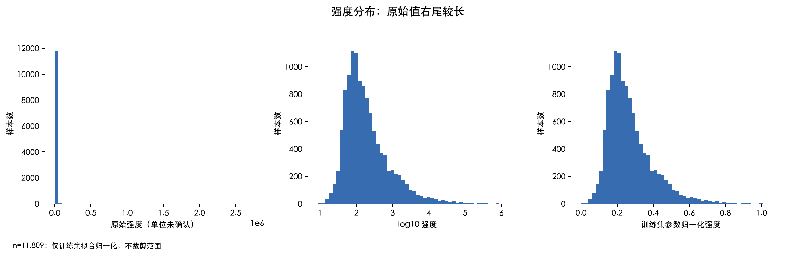
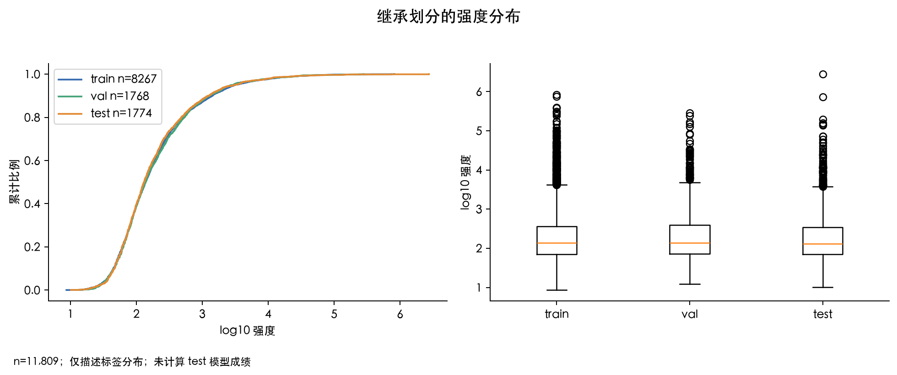
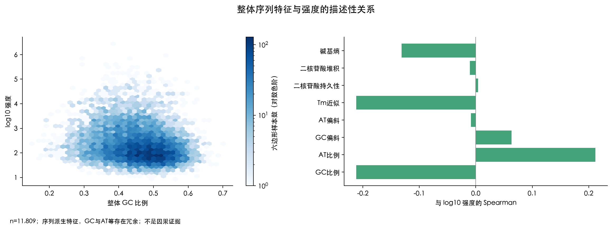
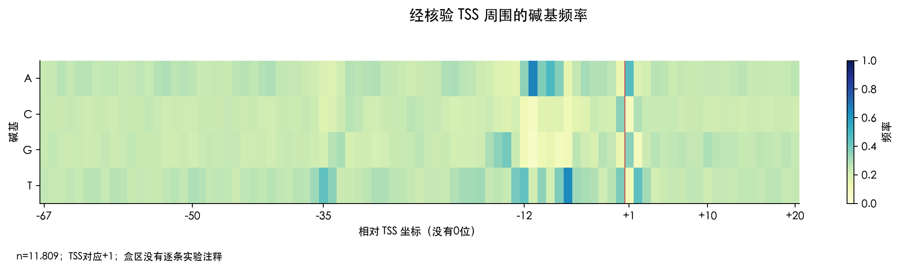
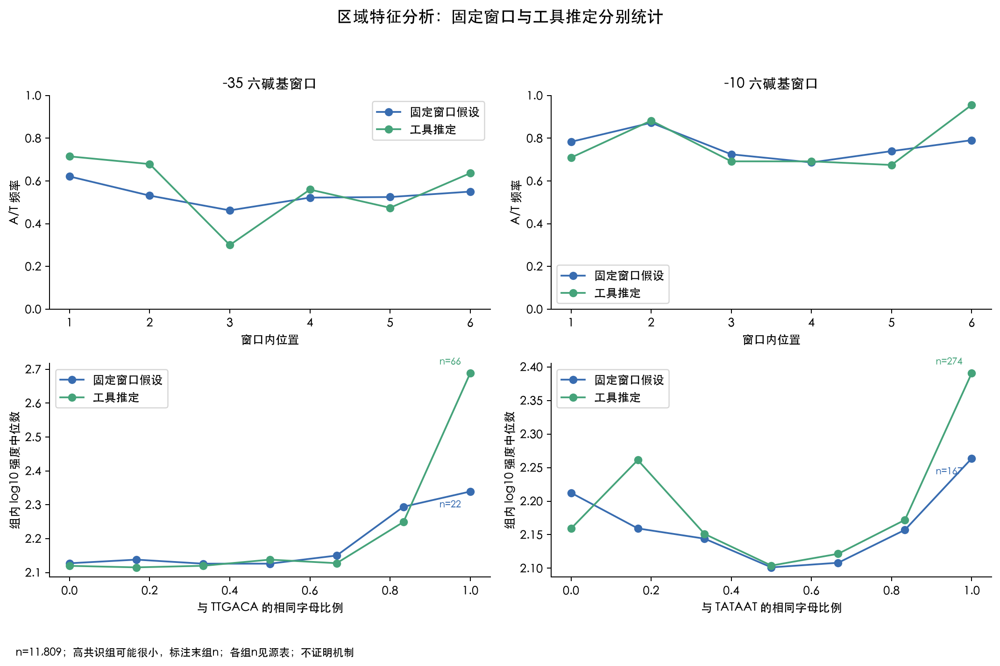
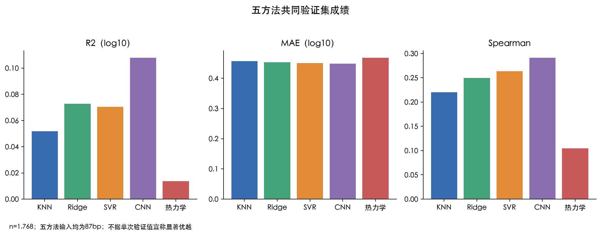
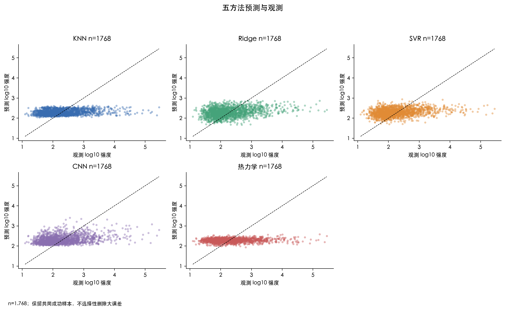
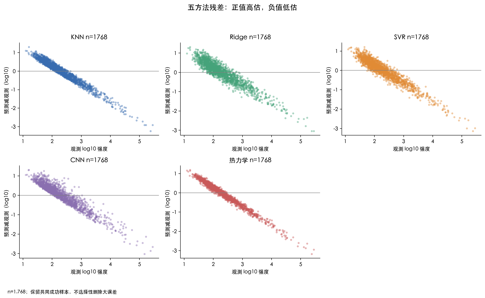
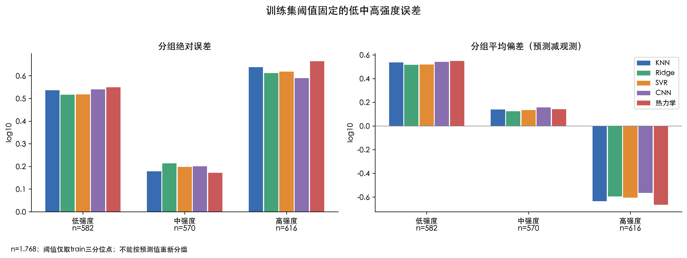
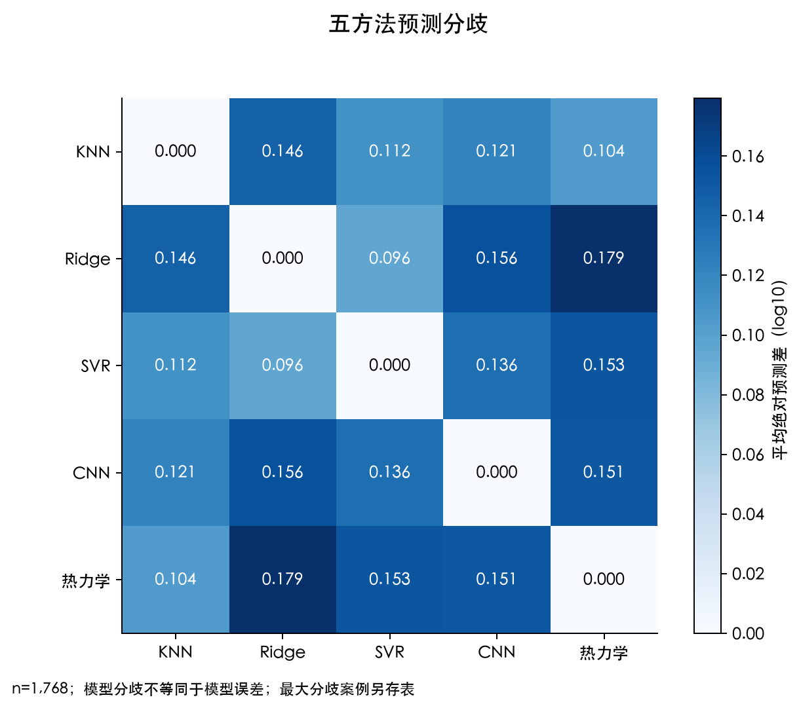

# E. coli 87 bp：M2 数据与区域分析、M3 误差与案例

## 当前发现

原始强度中位数为 136.760，最大值为 2755441.06，右尾较长。整体 GC 与 log10 强度的 Spearman 为 -0.2118。这是序列派生特征的描述性关系，不说明因果。

五方法在同一批 1,768 条共同成功验证样本上比较。当前冻结模型的数值如下，验证集也参与过队友选参，不把单次排名解释为稳定或显著优越。

| 方法 | R2(log10) | MAE(log10) | RMSE(log10) | Spearman |
|---|---:|---:|---:|---:|
| KNN | 0.0519 | 0.4569 | 0.6019 | 0.2202 |
| Ridge | 0.0727 | 0.4529 | 0.5953 | 0.2498 |
| SVR | 0.0705 | 0.4501 | 0.5960 | 0.2638 |
| CNN | 0.1079 | 0.4484 | 0.5839 | 0.2913 |
| 热力学 | 0.0136 | 0.4681 | 0.6140 | 0.1047 |

## M2：数据、归一化与区域来源

本次全部 11,809 条样本为方向已核验的 87 bp，划分计数为 {'train': 8267, 'test': 1774, 'val': 1768}。原强度未改变，87 bp 中 [17:67] 保留原 50 bp。历史参考 U00096.2 的恢复上下文逐条对照原论文 TSS 表；75 条多位置记录由上游排除并保存，分析未再删样本。

来源登记在 data/03_Ecoli_strength87/source_manifest.json，原作者库为 [Deep_promoter](https://github.com/HaochenW/Deep_promoter)，TSS依据为 [Thomason等论文](https://pmc.ncbi.nlm.nih.gov/articles/PMC4288677/) 的附件。标签实验单位与条件仍未确认，不写成荧光或RNA/DNA比值。

归一化读取正式 label_transform，不重新拟合：训练范围 0.9380190975 到 5.9142356017；clip=false。全体归一化范围为 0.0000 到 1.1057，超出[0,1]时保留。

TSS索引为67，对应生物坐标+1；相对坐标为−67…−1、+1…+20，没有0位。可靠实验来源核验的是TSS，不是每条−10/−35/UP盒区。区域表分别保存 canonical_window_assumption 和 model_inferred，六碱基共识匹配仅用 TTGACA/TATAAT 的相同字母比例，不称独立实测元件。工具间隔来自实际最小自由能状态；固定窗口的17bp间隔只是布局假设。

区域统计源表包含每条序列、窗口、坐标、GC、共识评分、均值和Spearman。盒区推定参与了热力学模型，因此其特征与热力学预测的关系不能作为独立验证。固定/推定两种范围的观察分别解释，不沿用旧81bp小子集结论。

| 窗口来源 | 区域 | 平均A/T比例 | GC与强度Spearman | 共识评分与强度Spearman |
|---|---|---:|---:|---:|
| 固定窗口假设 | -35 | 53.51% | -0.0855 | 0.0233 |
| 固定窗口假设 | -10 | 76.60% | -0.0111 | -0.0204 |
| 工具推定 | -35 | 56.06% | -0.0826 | 0.0445 |
| 工具推定 | -10 | 76.75% | -0.0268 | 0.0326 |

每行n=11,809。各共识匹配分组的n和中位数在region_similarity_groups.csv；高共识组可能很小，不将曲线末端当作稳定趋势。模型推定 spacer 长度的实际样本计数为 {15: 363, 16: 3354, 17: 6206, 18: 1816, 19: 70}；这些长度来自工具选择，不能称为实验测得的间隔。

## M3：分组误差与案例

低、中、高强度分界为训练集 log10 三分位点 1.9392695863、2.3832586817。低组≤第一阈值，中组>第一阈值且≤第二阈值，高组>第二阈值。分组表保存n、MAE、平均残差；正残差为高估，负残差为低估。

指标同时报告各方法全部成功样本及共同成功样本，raw/log10分开；缺失或常量导致无定义时保留undefined及原因，不填0。完整请求表保留失败行和原因；不能把Tx_rate直接作为原始strength预测。本轮未重新训练、校准或挑选模型，不评价E.coli test。

| 方法 | 强度组 | n | MAE(log10) | 平均偏差(log10) |
|---|---|---:|---:|---:|
| KNN | 低 | 582 | 0.5370 | 0.5370 |
| KNN | 中 | 570 | 0.1788 | 0.1405 |
| KNN | 高 | 616 | 0.6385 | -0.6352 |
| Ridge | 低 | 582 | 0.5174 | 0.5155 |
| Ridge | 中 | 570 | 0.2142 | 0.1255 |
| Ridge | 高 | 616 | 0.6129 | -0.5950 |
| SVR | 低 | 582 | 0.5184 | 0.5180 |
| SVR | 中 | 570 | 0.1986 | 0.1336 |
| SVR | 高 | 616 | 0.6184 | -0.6047 |
| CNN | 低 | 582 | 0.5409 | 0.5409 |
| CNN | 中 | 570 | 0.2009 | 0.1578 |
| CNN | 高 | 616 | 0.5901 | -0.5648 |
| 热力学 | 低 | 582 | 0.5497 | 0.5497 |
| 热力学 | 中 | 570 | 0.1723 | 0.1409 |
| 热力学 | 高 | 616 | 0.6646 | -0.6639 |

案例选择为每方法最大绝对log10误差5条、每对方法最大log10预测差5条，以及种子 20260928 的共同样本随机5条。同分按sample_id排序；重复入选保留规则身份。共 80 个选择记录、43 个不同样本。case_review.csv保留父ID、源行、87bp、TSS/方向、整体与区域特征、五方法预测和误差。最大误差来自每方法成功集合，分歧与随机来自共同集合；案例不代表全部数据，也不编造未实验核验的生物学原因。

## 图与数值源表

### 强度分布：原始值右尾较长

仅训练集拟合归一化，不裁剪范围。n=11,809，子集=all，尺度=raw/log10/normalized。源表：[samples.csv](source_tables/samples.csv)、[distributions.csv](source_tables/distributions.csv)。

### 继承划分的强度分布

仅描述标签分布；未计算 test 模型成绩。n=11,809，子集=train/val/test，尺度=log10。源表：[samples.csv](source_tables/samples.csv)。

### 整体序列特征与强度的描述性关系

序列派生特征，GC与AT等存在冗余；不是因果证据。n=11,809，子集=all，尺度=log10。源表：[samples.csv](source_tables/samples.csv)、[feature_correlations.csv](source_tables/feature_correlations.csv)。

### 经核验 TSS 周围的碱基频率

TSS对应+1；盒区没有逐条实验注释。n=11,809，子集=all，尺度=sequence。源表：[base_frequency.csv](source_tables/base_frequency.csv)。

### 区域特征分析：固定窗口与工具推定分别统计

高共识组可能很小，标注末组n；各组n见源表；不证明机制。n=11,809，子集=all，尺度=sequence/log10。源表：[region_base_frequency.csv](source_tables/region_base_frequency.csv)、[region_features.csv](source_tables/region_features.csv)、[region_summary.csv](source_tables/region_summary.csv)、[region_similarity_groups.csv](source_tables/region_similarity_groups.csv)。

### 五方法共同验证集成绩

五方法输入均为87bp；不据单次验证值宣称显著优越。n=1,768，子集=val_common，尺度=log10。源表：[metrics.csv](source_tables/metrics.csv)、[coverage.csv](source_tables/coverage.csv)、[evaluation_ids.csv](source_tables/evaluation_ids.csv)。

### 五方法预测与观测

保留共同成功样本，不选择性删除大误差。n=1,768，子集=val_common，尺度=log10。源表：[prediction_errors.csv](source_tables/prediction_errors.csv)、[evaluation_ids.csv](source_tables/evaluation_ids.csv)。

### 五方法残差：正值高估，负值低估

保留共同成功样本，不选择性删除大误差。n=1,768，子集=val_common，尺度=log10。源表：[prediction_errors.csv](source_tables/prediction_errors.csv)、[evaluation_ids.csv](source_tables/evaluation_ids.csv)。

### 训练集阈值固定的低中高强度误差

阈值仅取train三分位点；不能按预测值重新分组。n=1,768，子集=val_common，尺度=log10。源表：[group_errors.csv](source_tables/group_errors.csv)、[prediction_errors.csv](source_tables/prediction_errors.csv)。

### 五方法预测分歧

模型分歧不等同于模型误差；最大分歧案例另存表。n=1,768，子集=val_common，尺度=log10。源表：[model_disagreements.csv](source_tables/model_disagreements.csv)、[evaluation_ids.csv](source_tables/evaluation_ids.csv)。

## 解释边界

继承随机划分可能含邻近基因组上下文重叠，历史项目也曾报告test成绩。本轮验证分析不是全新盲测或外部泛化；没有额外显著性检验，区域相关性不代表实验机制，预测和案例不代表湿实验结果。
