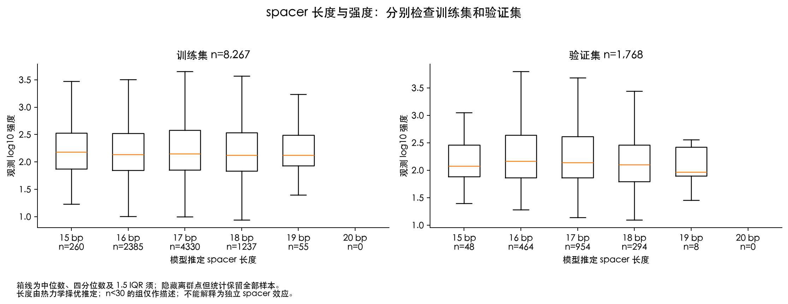
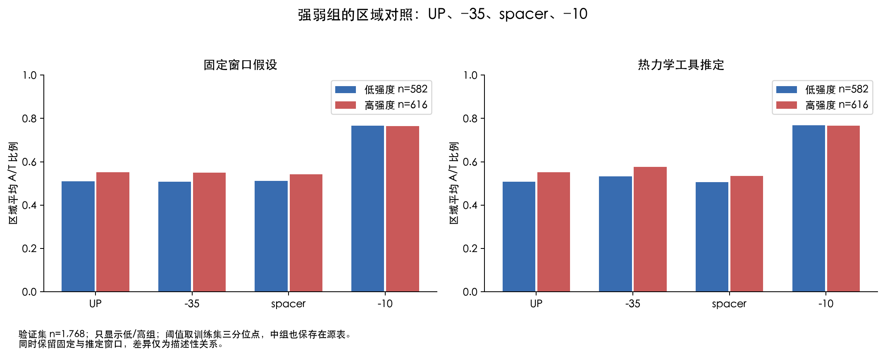
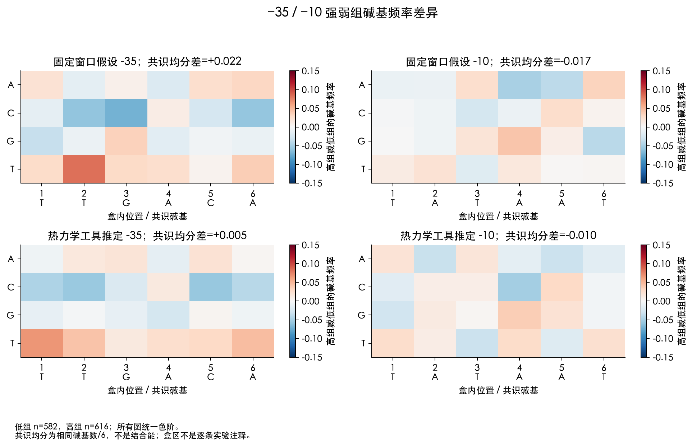
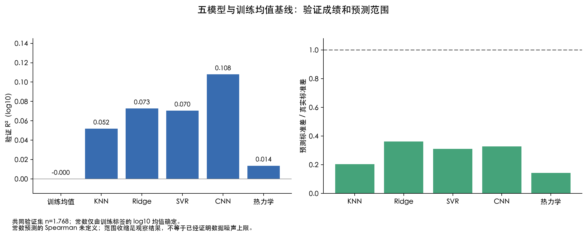
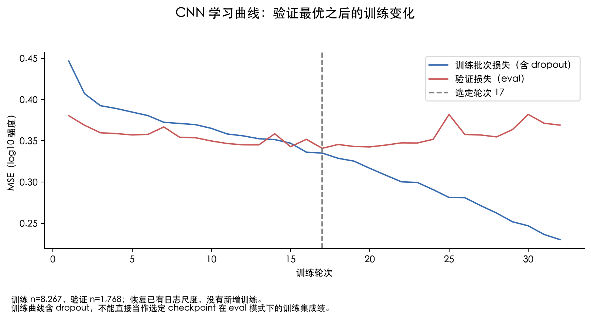

# E. coli 87 bp：M3 补齐与冻结基线

本次补齐 spacer 长度与强度关系、强弱组区域对照、五模型低分诊断。它与 [已有 M2/M3 分析](../ecoli87_m2m3_20261013_v1/analysis_report.md) 合起来构成当前 M3 交付。没有重训、改标签、改划分或新增 M4 实验；汇报材料不在本次范围。

## 1. spacer 长度与强度

验证集按工具推定长度的统计如下；训练集完整统计在 spacing_summary.csv。spacer 长度与 log10 强度的 Spearman：训练 -0.0008，验证 -0.0505，目前没有观察到强的单调关系。长度20没有被选中的样本仍记录 n=0、统计为空，不能填成0强度。

| spacer(bp) | n | 强度中位数(log10) | Q25 | Q75 | 样本状态 |
| --- | --- | --- | --- | --- | --- |
| 15 | 48 | 2.0750 | 1.8836 | 2.4575 | observed |
| 16 | 464 | 2.1684 | 1.8674 | 2.6405 | observed |
| 17 | 954 | 2.1383 | 1.8674 | 2.6174 | observed |
| 18 | 294 | 2.0987 | 1.7927 | 2.4636 | observed |
| 19 | 8 | 1.9687 | 1.8991 | 2.4233 | sparse_n_lt_30 |
| 20 | 0 | 未定义 | 未定义 | 未定义 | empty |

这些长度由固定 TSS 下最小自由能状态选择而来，同时改变盒区位置和 discriminator 长度，不能解释成实验 spacer 注释或独立的间距因果效应。n<30 仅用于提示小样本组；四分位数是样本分布，不是置信区间。固定窗口的 spacer 恒为17bp，不能用它估计长度相关性。

## 2. 强弱组的区域比较

低/中/高阈值仅由训练标签三分位点确定：1.9392695863、2.3832586817。按观测标签分组；训练与验证分开，未使用预测值选组。区域为 UP、−35、spacer、−10，两种窗口分别报告。下表是验证集高组减低组的平均 A/T 差异（比例单位）：

| 窗口 | 区域 | 低组n | 高组n | 低组A/T | 高组A/T | 高减低 |
| --- | --- | --- | --- | --- | --- | --- |
| 固定窗口假设 | -10 | 582 | 616 | 0.7660 | 0.7641 | -0.0020 |
| 固定窗口假设 | -35 | 582 | 616 | 0.5074 | 0.5503 | 0.0429 |
| 固定窗口假设 | UP | 582 | 616 | 0.5092 | 0.5525 | 0.0433 |
| 固定窗口假设 | spacer | 582 | 616 | 0.5124 | 0.5415 | 0.0291 |
| 热力学工具推定 | -10 | 582 | 616 | 0.7692 | 0.7660 | -0.0032 |
| 热力学工具推定 | -35 | 582 | 616 | 0.5326 | 0.5768 | 0.0442 |
| 热力学工具推定 | UP | 582 | 616 | 0.5080 | 0.5514 | 0.0434 |
| 热力学工具推定 | spacer | 582 | 616 | 0.5063 | 0.5348 | 0.0285 |

在验证集的推定窗口中，高组相对低组的平均 A/T 差为：UP +0.0434、−35 +0.0442、spacer +0.0285、−10 -0.0032。前三区域有 A/T 组成差异，−10 的组间差很小；固定窗口也分别报告以检查坐标假设影响。这里没有把均值差当作显著性检验。

−35/−10 共识匹配均分的对照如下；评分为相同字母数/6，不把单一共识得分等同于结合能或启动子活性：

| 窗口 | 区域 | 低组共识均分 | 高组共识均分 | 高减低 |
| --- | --- | --- | --- | --- |
| 固定窗口假设 | -10 | 0.4860 | 0.4694 | -0.0165 |
| 固定窗口假设 | -35 | 0.3024 | 0.3241 | 0.0217 |
| 热力学工具推定 | -10 | 0.6220 | 0.6117 | -0.0103 |
| 热力学工具推定 | -35 | 0.4550 | 0.4600 | 0.0049 |

region_group_summary.csv 保存低、中、高各组的 n、GC/AT、共识和长度统计；region_group_contrasts.csv 保存差异；region_group_base_frequency.csv 保存盒内逐位 A/C/G/T 频率。group_membership.csv 保留每条样本的分组。TSS 有来源证据，盒区仍是固定窗口假设或模型推定；仅作描述性比较，没有以这些统计证明生物学机制。

## 3. 五模型预测效果诊断

常数基线使用训练集 log10 标签均值 2.2817021551，训练/验证分别导出预测。五模型与基线在同一 1,768 条验证 ID 上比较，指标均为 log10 尺度。

| 方法 | R² | Spearman | MAE | RMSE | 预测/真实标准差 | RMSE较均值改善% |
| --- | --- | --- | --- | --- | --- | --- |
| train_mean | -0.0000 | 未定义 | 0.4716 | 0.6182 | 0.0000 | 0.0000 |
| knn | 0.0519 | 0.2202 | 0.4569 | 0.6019 | 0.2034 | 2.6321 |
| ridge | 0.0727 | 0.2498 | 0.4529 | 0.5953 | 0.3619 | 3.7063 |
| svr | 0.0705 | 0.2638 | 0.4501 | 0.5960 | 0.3112 | 3.5911 |
| cnn | 0.1079 | 0.2913 | 0.4484 | 0.5839 | 0.3277 | 5.5510 |
| thermo | 0.0136 | 0.1047 | 0.4681 | 0.6140 | 0.1425 | 0.6869 |

CNN 的验证 Pearson=0.3326，RMSE 相对训练均值改善 5.55%，预测标准差为真实值的 32.77%。结合已有分组残差，高估低组、低估高组和范围收缩说明当前预测信号较弱，不证明数据无法预测或已经达到性能上限。

| 方法 | 训练R² | 验证R² | 训练RMSE | 验证RMSE | 解释标记 |
| --- | --- | --- | --- | --- | --- |
| knn | 1.0000 | 0.0519 | 0.0000 | 0.6019 | knn_train_not_generalization_evidence |
| ridge | 0.1304 | 0.0727 | 0.5879 | 0.5953 | descriptive_gap_only |
| svr | 0.0923 | 0.0705 | 0.6007 | 0.5960 | descriptive_gap_only |
| cnn | 0.1906 | 0.1079 | 0.5672 | 0.5839 | descriptive_gap_only |
| thermo | 0.0203 | 0.0136 | 0.6240 | 0.6140 | descriptive_gap_only |

KNN 使用距离权重，训练样本以自身为零距离邻居，训练 R²=1 是插值性质，不能拿来判定模型很好或证明严重过拟合。其训练值从一般学习能力判断中排除。CNN 在第 17 轮选定 checkpoint；日志共 32 轮，后续训练损失下降而验证损失未改善。日志训练损失含 dropout；表中训练指标来自选定 checkpoint 的 eval 预测，两者不混用。

## 4. 数据与模型解释边界

[Deep_promoter 原论文](https://pmc.ncbi.nlm.nih.gov/articles/PMC7337522/) 在相同来源的天然 dRNA-seq 表达数据上报告 CNN 测试 Pearson=0.25，并讨论表达还受到其他调控因素影响。本次 CNN 验证 Pearson/Spearman、数据去重、长度、架构和划分与其不同，不能当作严格复现或直接宣称优于原论文。原论文第二轮 SVR 使用另一个合成启动子报告实验数据集，其 Pearson=0.57 不能用作这批天然表达标签的基准。

因此标签与短序列任务的匹配程度是需要继续验证的解释；具体标签单位、条件归属和不可约噪声仍未确定。[Promoter Calculator](https://www.nature.com/articles/s41467-022-32829-5) 的转录起始率与体内表达测量之间也可能受其他过程影响。KNN 的整体特征、无位置 k-mer，以及 CNN 的位置池化都有表达限制，但本次没有用新的受控模型对照量化各因素贡献，不能据此断言谁是主因。

## 5. M3 验收与后续范围

已完成：经核验数据与来源、五方法公共验证比较、−10/−35/UP/spacer 探索、spacer 与强度关系、强弱组区域对照、分组误差、极端与随机案例、训练均值对照和学习曲线诊断。原有图表、80条案例选择及其独立核验保留在已有 M2/M3 运行，本运行补齐上述三项。所有结论为当前继承随机划分上的初步分析。

本次只分析训练/验证样本，未生成 E. coli test 预测或成绩。阈值和常数仅取 train；标签、五模型 checkpoint/参数、val 预测、热力学状态和 M4/跨物种产物保持其冻结字节。邻近上下文可能重叠，历史 test 曾使用，不能称为全新盲测。M4 模型优化、归因/突变后续解释、消融与选做实验由后续安排；M3 完成不等同于 M4 完成或模型达到高准确率。

## 图与复算源表

### spacer 长度与强度：分别检查训练集和验证集

箱线为中位数、四分位数及 1.5 IQR 须；隐藏离群点但统计保留全部样本。 长度由热力学择优推定；n<30 的组仅作描述；不能解释为独立 spacer 效应。

### 强弱组的区域对照：UP、−35、spacer、−10

验证集 n=1,768；只显示低/高组；阈值取训练集三分位点，中组也保存在源表。 同时保留固定与推定窗口，差异仅为描述性关系。

### −35 / −10 强弱组碱基频率差异

低组 n=582，高组 n=616；所有图统一色阶。 共识均分为相同碱基数/6，不是结合能；盒区不是逐条实验注释。

### 五模型与训练均值基线：验证成绩和预测范围

共同验证集 n=1,768；常数仅由训练标签的 log10 均值确定。 常数预测的 Spearman 未定义；范围收缩是观察结果，不等于已经证明数据噪声上限。

### CNN 学习曲线：验证最优之后的训练变化

训练 n=8,267，验证 n=1,768；恢复已有日志尺度，没有新增训练。 训练曲线含 dropout，不能直接当作选定 checkpoint 在 eval 模式下的训练集成绩。
