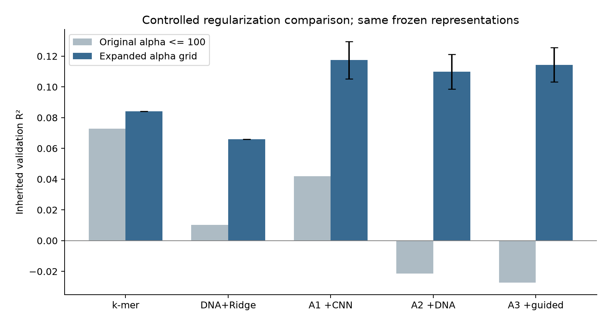
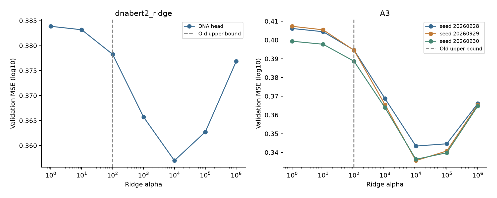
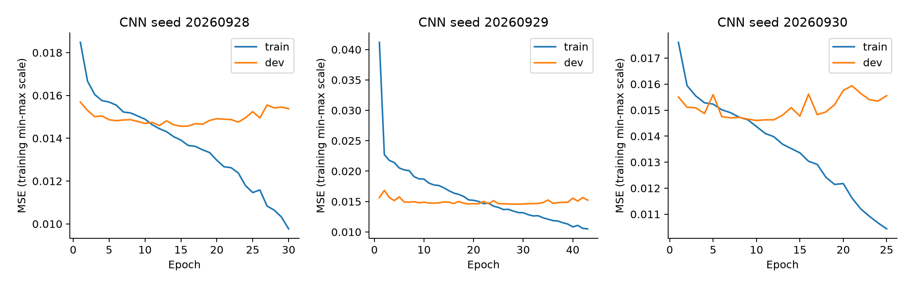
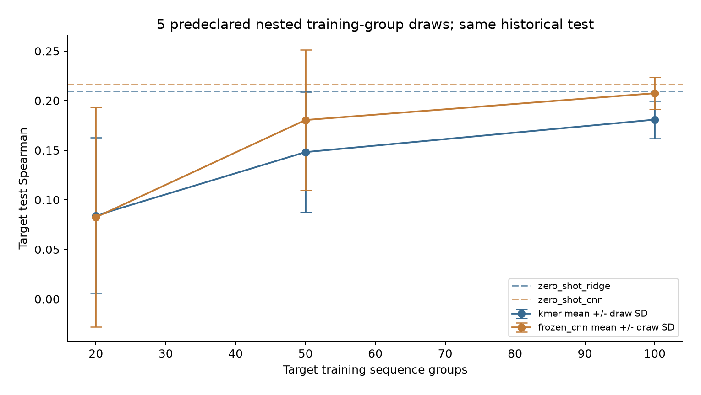

# PR02-01 项目完善核验

本轮是实验修订与质量检查，项目最终内容待确认。PPT、Word及旧版正式报告保持原版本。

运行：`runs/m4_refinement_20261014_v2`。基线：`runs/m4_complete_20261014_v1`。

## 1. 原划分上的正则化对照

仅扩大回归头alpha范围，使用同样的特征、训练样本和三个CNN种子。所有候选都保留。此表的验证集参与选参，因此是受选择影响的描述性结果。

| 模型 | 原R² | 修订R²均值 | 种子SD | Spearman均值 |
| --- | --- | --- | --- | --- |
| kmer_ridge | 0.0727 | 0.0842 | 未定义 | 0.2733 |
| dnabert2_ridge | 0.0102 | 0.0659 | 未定义 | 0.2497 |
| A1 | 0.0418 | 0.1174 | 0.0121 | 0.3118 |
| A2 | -0.0215 | 0.1100 | 0.0113 | 0.3043 |
| A3 | -0.0273 | 0.1144 | 0.0113 | 0.3094 |

旧版负结果应限定为旧参数范围下的结果。扩展搜索后的变化不能直接归因于增加新生物信息，也不能代替独立数据评价。

## 2. 基因组区域分组验证

在原train+val中按20000bp区域分组，train/dev/evaluation分别为5985/2003/1998条。排除跨区域边界窗口49条，原test全部排除。双链窗口在任意两集合间的重叠均为0；相同序列及反向互补副本也不跨集合。

CNN采用预先固定的C0结构重新训练三个种子；归一化、scaler、热力学校准、归因选区均只拟合新train，回归头alpha和CNN早停只看dev。evaluation不用于这些选择。DNA编码器为固定的外部预训练权重，可复用未使用本项目标签的表征。

| 模型 | R²均值 | 种子SD | Spearman均值 | RMSE均值 |
| --- | --- | --- | --- | --- |
| kmer_ridge | 0.0868 | 未定义 | 0.2978 | 0.6066 |
| dnabert2_ridge | 0.0713 | 未定义 | 0.2673 | 0.6117 |
| knn | 0.0395 | 未定义 | 0.2051 | 0.6221 |
| linear_svr | 0.0731 | 未定义 | 0.2684 | 0.6111 |
| thermo | 0.0357 | 未定义 | 0.1774 | 0.6233 |
| train_mean | -0.0004 | 未定义 | 未定义 | 0.6349 |
| cnn | 0.0993 | 0.0049 | 0.2982 | 0.6024 |
| A1 | 0.1162 | 0.0006 | 0.3177 | 0.5967 |
| A2 | 0.1073 | 0.0130 | 0.3167 | 0.5997 |
| A3 | 0.1130 | 0.0036 | 0.3158 | 0.5978 |

| 相对k-mer Ridge的对照 | ΔR² | 95%区域bootstrap区间 |
| --- | --- | --- |
| cnn_minus_kmer_ridge | 0.0125 | -0.0090 至 0.0323 |
| A1_minus_kmer_ridge | 0.0294 | 0.0093 至 0.0468 |
| A2_minus_kmer_ridge | 0.0205 | 0.0041 至 0.0341 |
| A3_minus_kmer_ridge | 0.0262 | 0.0041 至 0.0447 |
| dnabert2_ridge_minus_kmer_ridge | -0.0155 | -0.0285 至 -0.0025 |

误差线中的种子SD只反映训练随机性；区域bootstrap只反映固定模型在本次分组评价样本上的波动。原划分与分组划分样本组成不同，不能把分数差全部解释为数据泄漏的大小。这是单次内部空间分组对照，历史标签曾参与项目开发，仍不是独立外部盲测。

## 3. 位点解释的跨种子稳定性

原先的IG/ISM一致性仍保留；本轮另比较三个CNN种子。种子对在同一母序列内先汇总，再按64条母序列bootstrap，避免把种子对当作独立生物样本。

| 归因方法 | Top-k | 跨种子指标 | 均值 | 95%母序列区间 |
| --- | --- | --- | --- | --- |
| integrated_gradients | 5 | spearman | 0.2861 | 0.2677 至 0.3045 |
| integrated_gradients | 5 | top_k_jaccard | 0.2024 | 0.1768 至 0.2272 |
| integrated_gradients | 10 | spearman | 0.2861 | 0.2677 至 0.3045 |
| integrated_gradients | 10 | top_k_jaccard | 0.2274 | 0.2106 至 0.2462 |
| ism_mean_absolute | 5 | spearman | 0.4242 | 0.4018 至 0.4458 |
| ism_mean_absolute | 5 | top_k_jaccard | 0.2522 | 0.2248 至 0.2808 |
| ism_mean_absolute | 10 | spearman | 0.4242 | 0.4018 至 0.4458 |
| ism_mean_absolute | 10 | top_k_jaccard | 0.2743 | 0.2532 至 0.2954 |

| 方法 | 窗口政策 | Top-k | −10富集均值 | 正向种子数/总数 |
| --- | --- | --- | --- | --- |
| integrated_gradients | fixed | 5 | 0.1237 | 3/3 |
| integrated_gradients | fixed | 10 | 0.0790 | 3/3 |
| integrated_gradients | PC_inferred | 5 | 0.1248 | 3/3 |
| integrated_gradients | PC_inferred | 10 | 0.0836 | 3/3 |
| ism_mean_absolute | fixed | 5 | 0.1685 | 3/3 |
| ism_mean_absolute | fixed | 10 | 0.1201 | 3/3 |
| ism_mean_absolute | PC_inferred | 5 | 0.1717 | 3/3 |
| ism_mean_absolute | PC_inferred | 10 | 0.1290 | 3/3 |

区域富集与具体位点稳定性分别解释。均匀位置参照没有消除所有TSS位置偏好；本轮没有进行多重检验显著性声明，固定或PC推定窗口也不是逐条实测结合注释。

## 4. 跨物种训练抽样稳定性

目标域沿用原序列组划分。每次预定抽样内20/50/100组嵌套，共5次，所有结果完整报告。目标训练组拟合，目标val选alpha；目标test不用于选抽样或条件。CNN源权重保持冻结，Ridge zero-shot采用本轮扩展alpha后的源域头。

| 条件 | 抽样次数 | Spearman均值 | 抽样SD | 抽样最小/最大 |
| --- | --- | --- | --- | --- |
| zero_shot_ridge | 1 | 0.2095 | 未定义 | 0.2095 / 0.2095 |
| zero_shot_cnn | 1 | 0.2161 | 未定义 | 0.2161 / 0.2161 |
| few_shot_kmer_20_groups | 5 | 0.0841 | 0.0788 | -0.0372 / 0.1560 |
| few_shot_frozen_cnn_20_groups | 5 | 0.0824 | 0.1107 | -0.0733 / 0.2349 |
| few_shot_kmer_50_groups | 5 | 0.1481 | 0.0605 | 0.0856 / 0.2377 |
| few_shot_frozen_cnn_50_groups | 5 | 0.1805 | 0.0709 | 0.0628 / 0.2484 |
| few_shot_kmer_100_groups | 5 | 0.1809 | 0.0189 | 0.1524 / 0.2000 |
| few_shot_frozen_cnn_100_groups | 5 | 0.2075 | 0.0162 | 0.1866 / 0.2219 |

抽样SD与单次test序列组bootstrap区间分别保存。目标test曾在历史实验中使用；教师CSV缺少单位和测量条件，因此主要解释排序相关，跨物种绝对误差只作尺度诊断。

## 5. 工程修复与验收入口

配置中的种子、CNN候选、归因样本数和bootstrap参数实际生效。断点复用检查产物、上游文件、完整配置、协议及执行源码；配置或源码变化要求新run。旧源码按摘要归档，历史结果可核验，不能静默当作新代码运行。

报告和图表写入各自run目录。正式PPT/Word没有随实验重新生成。图像检查必须显式登记，登记前不会通过完整验收。

```bash
python -m pr02 m4-refine --protocol configs/m4_refinement_v2.json --stage verify
```

当前修订的数值与结论以本文件及其源表为准。旧版M5材料保持历史身份，待项目最终确认后统一更新。

## 图与源表索引

### 01_regularization_comparison

只扩大Ridge正则化范围；融合显示三个匹配种子的均值与样本标准差。验证集参与选参，数值不代表独立泛化。



源表：`runs/m4_refinement_20261014_v2/regularization/summary.csv`、`runs/m4_refinement_20261014_v2/regularization/matched_comparison.csv`

### 02_regularization_search

完整保留预定七档alpha的误差曲线，不只展示获胜参数。



源表：`runs/m4_refinement_20261014_v2/regularization/search.csv`

### 03_grouped_validation

20kb区域分组，跨集合87bp窗口重叠为零；重新训练CNN、回归头、热力学校准和训练归因配方。超参数及早停只看dev。误差线为训练种子标准差。


源表：`runs/m4_refinement_20261014_v2/grouped/summary.csv`、`runs/m4_refinement_20261014_v2/grouped/split_audit.json`

### 04_grouped_learning_curves

分组验证CNN的训练与开发集曲线；evaluation标签不参与早停。



源表：`runs/m4_refinement_20261014_v2/grouped/cnn_s20260928/training_history.csv`、`runs/m4_refinement_20261014_v2/grouped/cnn_s20260929/training_history.csv`、`runs/m4_refinement_20261014_v2/grouped/cnn_s20260930/training_history.csv`

### 05_attribution_seed_stability

同一64条母序列、三个CNN种子的固定区域富集。跨种子稳定性与同模型IG/ISM一致性是不同指标；仍为描述性分析。


源表：`runs/m4_refinement_20261014_v2/attribution_stability/region_by_seed.csv`

### 06_transfer_training_draws

误差线表示训练组抽样的标准差；每次抽样的目标test序列组bootstrap区间另存metrics.csv。目标test曾被使用，未称为新盲测。



源表：`runs/m4_refinement_20261014_v2/transfer_stability/summary.csv`
